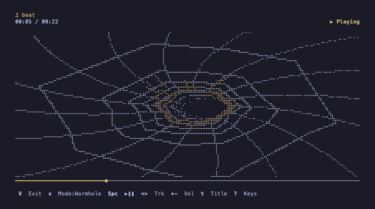

# cliamp-plugin-wormhole

A wireframe tunnel visualizer for [cliamp](https://github.com/bjarneo/cliamp), drawn in Braille dots.



Rings leave the mouth in the middle and grow past the edges. With a steady beat one ring leaves per kick; without one the tunnel cruises. A kick sends a shock wave down the tunnel, a snare rocks the wall, a hi-hat throws sparks, and a sudden jump in energy starts a short warp. The wall bulges where the music was loud, bass at the bottom and treble at the top, and its cross-section moves between circle, hexagon, square and star with the tone of the track.

## Install

```sh
cliamp plugins install konstantindenerz/cliamp-plugin-wormhole
```

Start cliamp and press `v` until you reach `Wormhole`, or pick it with `Ctrl+V`. Press `V` for full screen. To start with it, set `visualizer = "Wormhole"` in `config.toml`.

```sh
cliamp plugins remove wormhole
```

## Configuration

All keys are optional. They go into `~/.config/cliamp/config.toml`:

```toml
[plugins.wormhole]
# Wait this long before the tunnel reacts, when it is ahead of the sound.
delay_ms = 0
# Colors: a palette index (0-255) or "#rrggbb".
# Wall and far rings, near rings, kick waves, hard hits.
dim = 7
text = 15
beat = 11
hot = 9
```

The default colors are the gray, white, yellow and red of your terminal, so the tunnel follows the terminal theme. It does not follow the cliamp theme: a plugin cannot read it.

## Notes

- The beat sync needs a cliamp that gives plugins the sound as it plays ([bjarneo/cliamp#738](https://github.com/bjarneo/cliamp/pull/738)). Up to v2.4.1 a plugin gets the audio in bursts and ahead of the sound: the tunnel flies, but it misses kicks and rarely locks to the beat. `delay_ms = 175` lines up the kicks it does catch.
- The terminal font needs the Braille block (U+2800 to U+28FF).
- cliamp gives a plugin 50 ms for a frame. A full-screen frame at 140x40 takes about a third of that on an Apple M-series CPU. On a very large terminal the plugin sets fewer dots per ring to stay in time.
- While playback is paused the tunnel eases to a stop. Silence stops it too.

## Development

```sh
cp wormhole.lua ~/.config/cliamp/plugins/
cliamp plugins trust wormhole
```

cliamp loads plugins at start and asks for the trust step again after each edit. Errors go to `~/.config/cliamp/plugins.log`.

The tests run the plugin in the Lua VM that cliamp uses, with stand-ins for cliamp:

```sh
cd test && go test ./...
```

After a change that is meant to alter the picture, `go test -update` records the frames in `test/testdata/frames.txt` again.

## License

MIT
